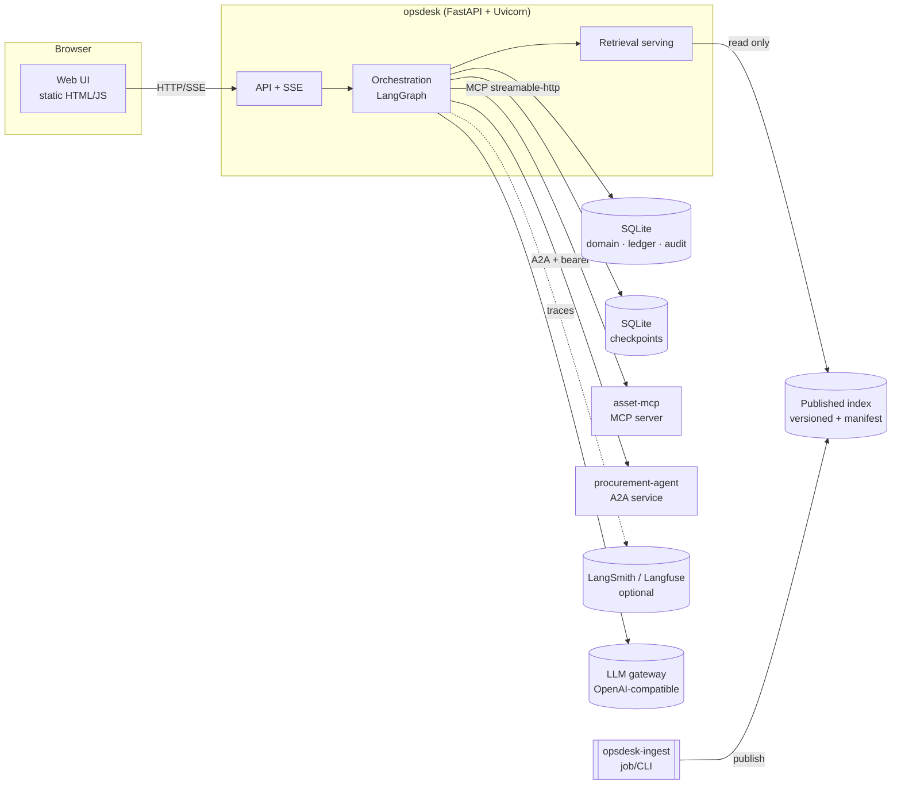
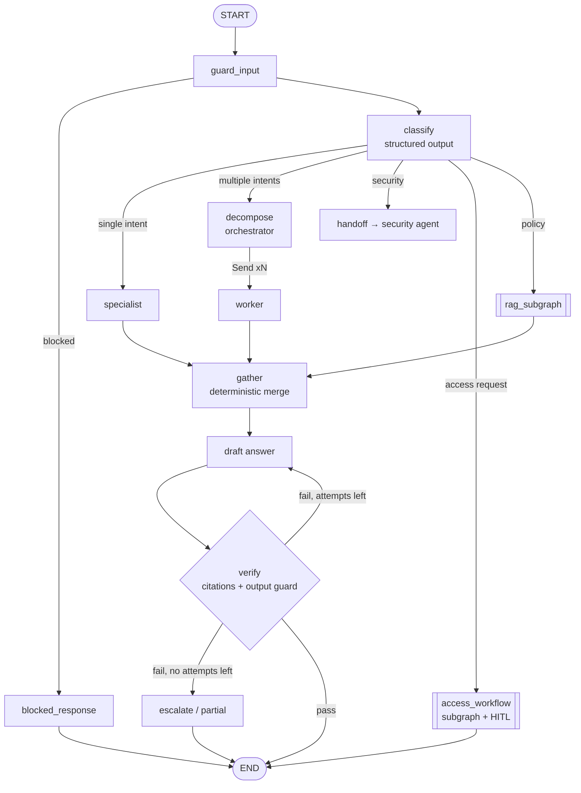

# OpsDesk — Architecture

> An internal IT Helpdesk assistant built as a production-grade **agent harness**.
> This document is the architectural source of truth for both Claude Chat (guidance) and Claude Code (implementation).
> Every architectural change must come with an ADR in `docs/adr/`.

---

## 1. Problem

Employees of **Acme** chat with OpsDesk to:

| Need | Example | Course topics applied |
|---|---|---|
| Ask about policies / how-tos | "What is the password policy?", "How do I set up the VPN?" | Permission-aware RAG, skills |
| Look up their own tickets / devices | "Where is my ticket T-1042?", "Is my laptop still under warranty?" | Tools, ownership, MCP (asset system) |
| Report an incident | "My laptop is very slow after the update" | Tool-calling agent, diagnosis, ticket creation |
| Request access / a licence | "I need a Figma licence", "I need admin rights on my machine" | Deterministic workflow, approval gate, HITL, audit, idempotency |
| Buy new equipment | "I need a second monitor" | A2A call to an independently deployed Procurement Agent |
| Security incident | "I just clicked a phishing link" | Handoff to a Security Agent (which owns the following turns) |
| Multi-intent request | "My laptop is slow, and I need a Figma licence" | Router / orchestrator-worker, parallel execution |
| Weekly operations report (IT Manager) | "Write this week's report" | Deep Agents, read-only tools, artifact |

**Personas (seed data):** regular employee (`employee`), HR staff (`hr`), Finance (`finance`), IT staff (`it_staff`), IT Manager (`it_manager`, can approve). A second tenant (**Globex**) exists only to test tenant isolation.

**Single currency:** VND. **Every threshold lives in the policy config**, never hardcoded.

---

## 2. Architectural principles

1. **The five harness layers are built once and stay stable**: Orchestration · Context · Tools · Verification/Governance · Operations. Later milestones only *plug into* the right layer.
2. **Hexagonal (ports & adapters)**: domain and policy are plain Python with no I/O and no frameworks. LangChain, LangGraph, FastAPI, MCP, A2A, Langfuse and the rest are adapters at the edges.
3. **Dependency rules are enforced by tooling** (`import-linter` in CI), not just written down.
4. **Deterministic first, model second**: whatever code can decide, code decides. The model only *proposes*; policy *decides*.
5. **Identity always comes from the server** (signed token → `Principal`), never from user text, model output or retrieved data.
6. **Fail closed**: missing identity, missing ACL, broken index or exhausted budget → controlled refusal, never a best guess.
7. **One contract per concept**: one event schema, one result envelope, one dataset format, one policy config.
8. **Use the smallest sufficient abstraction** for each workload, and record the choice in an ADR.

---

## 3. Topology — processes



| Process | Role | Why it is a separate process |
|---|---|---|
| `opsdesk` | API, UI, orchestration, retrieval serving | Main application |
| `opsdesk-ingest` | RAG Pipeline A: parse → chunk → ACL → index → publish | Different trigger (document/ACL changes), lifecycle and failure modes (W2 L2) |
| `asset-mcp` | Simulates the company's *asset management system* and owns device data | An external capability with its own owner; multiple clients can share it (W2 L1) |
| `procurement-agent` | A purchasing agent operated by "the Procurement department", with long-running tasks that need human approval | Has its own identity, task lifecycle and deployment boundary (W4 L4) |

Kept **in-process**: specialist agents, the RAG subgraph and the Deep Agent report (run as a workload/job inside `opsdesk`). Reason: they have no separate ownership boundary, so an in-process call is enough (W4 L3, L4).

---

## 4. Code layers and dependency rules

```
      api  ·  evaluation             ← entry points: FastAPI/SSE/UI; evaluation runners
               │
   orchestration  ·  workloads       ← LangGraph graphs, patterns, approvals; Deep Agent report
               │
             agents                  ← specialist factory, prompts, skills
               │
       tools  ·  retrieval           ← tool registry/wrapper, MCP/A2A clients; RAG serving
               │
  security · observability · cost · resilience · llm · persistence   ← shared infrastructure
               │
             domain                  ← models + policies (plain Python)
               │
              core                   ← config, ids, clock, errors, envelope, money
```

`opsdesk.ingestion` sits outside the layer chain: it may only import `retrieval.contract`, `domain` and `core`.

**Rule (import-linter, `layers` contract):** an upper layer may import a lower layer, **never the reverse**.

Additional contracts:
- `domain` may only import `core` (plus the standard library and pydantic).
- No serving module (`api`, `orchestration`, `agents`, `retrieval`) may import `opsdesk.ingestion`. The two pipelines share only `opsdesk.retrieval.contract`.
- `services/asset_mcp` and `services/procurement_agent` do **not** import `opsdesk` (they are "external" systems).

---

## 5. Repository layout

```
opsdesk/
├── pyproject.toml              # uv, ruff, pyright, pytest, import-linter, poe tasks (dev | test | check | eval | ingest | mcp | a2a)
├── CLAUDE.md                   # rules for Claude Code
├── .importlinter
├── .env.example
├── .vscode/                    # shared settings.json + extensions.json
├── docs/
│   ├── architecture.md
│   ├── adr/                    # 0001-layered-hexagonal.md, ...
│   └── milestones/             # M00.md, M01.md, ...
├── config/
│   ├── policy.yaml             # tunables: approval thresholds, gates, budgets, retry/timeout
│   └── pricing.yaml            # model prices per 1M tokens, with effective dates
├── data/
│   ├── seed/                   # tenants, employees, tickets, software catalogue
│   └── kb_sources/             # ingestion source documents (md, pdf) + acl.yaml
├── evals/
│   └── datasets/               # golden.yaml, regression.yaml, redteam.yaml, retrieval.yaml
├── src/opsdesk/
│   ├── core/                   # settings, ids, clock, errors, envelope, money
│   ├── domain/                 # models.py, policies/ (access, approval, eligibility)
│   ├── security/               # principal, authz, guards/, audit/
│   ├── observability/          # events (schema v1), bus, sinks/, redaction
│   ├── cost/                   # pricing, ledger, budget, middleware
│   ├── llm/                    # model factory (roles), fake models, callbacks
│   ├── resilience/             # timeout, retry, circuit_breaker
│   ├── persistence/            # sqlite, repositories, checkpointer
│   ├── tools/                  # registry, wrapper, internal/, mcp_client, a2a_client
│   ├── retrieval/
│   │   ├── contract.py         # index contract v1 (shared with ingestion)
│   │   └── serving/            # loader, acl_filter, retrievers, fusion, planner, verifier
│   ├── ingestion/              # Pipeline A (entry point: opsdesk-ingest)
│   ├── agents/                 # factory, specialists/, prompts/, skills/
│   ├── orchestration/
│   │   ├── patterns/           # router, subagent, handoff, skill (UI tabs)
│   │   ├── helpdesk_graph.py   # main graph
│   │   ├── access_workflow.py  # access-request workflow (HITL)
│   │   └── rag_subgraph.py
│   ├── workloads/
│   │   └── reports/            # operations report Deep Agent
│   ├── evaluation/             # AgentResult from the event log, evaluators, runners
│   └── api/                    # app, routes/, auth, schemas, stream_adapter
├── web/                        # index.html, app.js, styles.css (no build step)
├── services/
│   ├── asset_mcp/              # MCP server (FastMCP) with its own asset data
│   └── procurement_agent/      # A2A server, Agent Card, its own task store
├── tests/
│   ├── unit/  integration/  contract/
└── var/                        # (gitignored) db, checkpoints, index, traces, artifacts
```

---

## 6. Core contracts

### 6.1 Principal & RequestContext (W1 L2, W2 L2, W3 L1)

```python
class Principal(BaseModel, frozen=True):          # security/principal.py
    tenant_id: TenantId
    user_id: EmployeeId
    department: Department
    roles: frozenset[Role]
    scopes: frozenset[Scope]        # coarse: may this user call this kind of tool at all?
    groups: frozenset[str]          # RAG ACL groups: role names + "dept:<department>"

class RequestContext(BaseModel, frozen=True):     # security/context.py
    principal: Principal
    request_id: RequestId           # correlation id for events / traces / audit / ledger
    thread_id: ThreadId
    workload: Workload              # chat | eval | report
```

- `principal_for(employee)` is the only place scopes and groups are derived. Scopes are coarse (tool-level); domain policies (M01) stay fine-grained (entity-level). A tool call needs both. The role → scope table is code (`security/scopes.py`), not configuration.
- `observability` depends only on `core`: the event recorder takes `request_id`/`thread_id`, never a `RequestContext`. `Workload` lives in `core` because security, observability, cost and evaluation all use it.

- Built by the API from a signed token. Passed into graphs through LangGraph's `context_schema` / runtime context, **never** placed in messages sent to the model.
- Tools receive `RequestContext` through the runtime, not through arguments filled in by the model.

### 6.2 Result envelope for tools/workers (W1, W2 L1, W4 L1)

```python
class ToolResult(BaseModel, Generic[T]):
    status: Literal["ok", "empty", "not_found", "denied", "invalid", "unavailable", "timeout"]
    data: T | None = None
    safe_message: str | None = None   # safe for the model/UI to see
    error_code: str | None = None      # for logs/evals; no internal details
```

Error taxonomy (used everywhere: retries, gates, evals, UI):

| Class | Status | Retry? | Example |
|---|---|---|---|
| Business | `not_found`, `empty`, `invalid` | No | Ticket does not exist |
| Policy | `denied` | No | Not the ticket owner, missing scope |
| Transient | `unavailable`, `timeout` | Yes, bounded | MCP server is down |
| Budget | (`BudgetExceeded` exception) | No | Turn budget exceeded |

### 6.3 Event schema v1 (W1 L3–L4, W2 L3, W3)

```python
class Event(BaseModel):
    schema_version: Literal["opsdesk.event.v1"]
    seq: int                         # ordering within a run (not timestamp-based)
    event_id: str
    ts: datetime
    request_id: str
    thread_id: str
    namespace: tuple[str, ...]       # subgraph / agent path
    kind: EventKind
    payload: dict                    # redacted, kind-specific
```

`EventKind`: `run_started`, `node_started`, `node_finished`, `route_decided`, `token`, `tool_started`, `tool_finished`, `retrieval_done`, `guard_verdict`, `gate_fired`, `approval_required`, `approval_resolved`, `handoff`, `usage_recorded`, `budget_blocked`, `run_finished` (`completed | blocked | interrupted | failed`).

`payload` is validated against one pydantic model per kind (`observability/events.py`); a kind without a registered payload model cannot be emitted. Within `v1`, adding kinds or optional payload fields is allowed; renaming/removing fields or changing types requires `opsdesk.event.v2`. JSON-schema snapshots in `tests/contract/snapshots/` make any change visible in review.

One event goes to several **sinks**: SSE (filtered through an allowlist), local JSONL (always on) and evaluation (to build `AgentResult`). Traces to LangSmith/Langfuse go through separate callbacks; **audit** records are written through a dedicated API, not through the event bus.

> Three concepts must stay separate: **event** (stream/UI/eval) · **trace** (observability backend) · **audit** (tamper-evident evidence). All three share the same `request_id`.

### 6.4 Repositories and tenant scoping (M01)

Every repository lookup takes a `tenant_id`, so tenant isolation is enforced by the shape of the API. The one deliberate exception is `SoftwareRepository`: the software catalogue is global by design and contains no tenant data (ownership of a licence lives on `Employee`, which is tenant-scoped).

### 6.5 Index contract v1 (W2 L2)

```python
class IndexedChunk(BaseModel, frozen=True):
    chunk_id: str                    # {source_id}:{source_version}:{n}
    source_id: str
    source_version: str
    tenant_id: str
    allowed_groups: frozenset[str]   # required, never empty
    modality: Literal["text", "table", "image"]
    locator: str                     # file#section, page=4, Sheet1!B7
    text: str
    checksum: str
    embedding_model: str | None
    indexed_at: datetime

class IndexManifest(BaseModel):
    schema_version: Literal["opsdesk.index.v1"]
    index_version: str
    published_at: datetime
    chunk_count: int
    embedding_model: str | None
```

Ingestion writes a new version directory → validates → atomically switches the `CURRENT` pointer file (written to a temp file, then `os.replace`; no symlinks, so it works on Windows). Serving resolves `CURRENT`, checks `schema_version`, and fails closed if the index is missing or broken.

### 6.6 Policy config (W3 L1, L3)

`config/policy.yaml`, loaded with pydantic and validated at startup:

```yaml
currency: VND
approval:
  license_cost_review_vnd: 5_000_000
  admin_rights: always_review
gates: [high_value, admin_rights, output_guardrail]
budgets_vnd:
  turn: 2_000
  thread: 20_000
  day_chat: 500_000
  day_eval: 200_000
resilience:
  llm:  {timeout_s: 30, attempts: 2, backoff_s: [1, 3]}
  mcp:  {timeout_s: 5,  attempts: 2, backoff_s: [0.5], breaker: {threshold: 3, cooldown_s: 30}}
```

---

## 7. Orchestration — which workload uses what (W4 L3)

| Workload | Abstraction | Reason |
|---|---|---|
| Permission checks, approval thresholds, eligibility | **Plain Python** (`domain/policies`) | Fixed rules; a model would only make them less reliable |
| Specialists (tickets, KB, hardware, security) | **LangChain `create_agent`** + middleware | Standard model/tool loop |
| Main helpdesk graph | **LangGraph** | Needs explicit state, branching, fan-out, subgraphs, retries |
| Access-request workflow | **LangGraph** + interrupt + checkpointer | HITL, resume, idempotency |
| Weekly operations report | **Deep Agents** | Long-horizon, multiple sources, produces an artifact |
| Procurement | **A2A** to an independent service | Separate owner and task lifecycle |
| Asset system | **MCP** | Shared external capability |

### Main helpdesk graph (target shape, built up over the milestones)



The **Router / Subagent / Handoff / Skill** tabs in the UI remain as separate demonstration graphs (`orchestration/patterns/`), sharing the same tools, model factory and event schema as the main graph.

---

## 8. Governance & operations

| Concern | Mechanism | Where |
|---|---|---|
| Prompt injection from the user | Input guard (user channel → block) | First node of the graph, before any model call |
| Injection inside data | Neutralizer (wraps content as `UNTRUSTED`) | Centrally in the tool wrapper, retrieval, MCP/A2A clients |
| Wrong promises / missing citations | Output guard → issue → gate | `verify` node |
| Sensitive actions | Approval gate + `interrupt` + reviewer with the `access:approve` scope | `access_workflow` + `/approvals` endpoint |
| Duplicate writes on retry/resume | Idempotency key | Repositories + write tools |
| Flaky dependencies | Timeout + retry (transient errors only) + circuit breaker | `resilience/`, attached to the LLM, MCP and A2A clients |
| Evidence | Append-only, hash-chained audit with `verify_chain` | `security/audit` → SQLite |
| Cost | Usage → ledger (Decimal VND, de-duplication key) → budget reserve/settle before each model call | `cost/` middleware |
| Traceability | Local events always on; LangSmith/Langfuse enabled via env | `observability/sinks` + callbacks from the model factory |
| Quality | Deterministic CI gate → judge-based DeepEval (scheduled) → separate red-team suite | `evaluation/`, `evals/datasets` |

---

## 9. Technology & versions

**Policy:** always use **the latest versions that install together**. Declare them in `pyproject.toml` as `>=current,<next major`; `uv.lock` pins exact versions. To upgrade: `uv lock --upgrade` → commit if `uv run poe check` passes on both CI platforms.

**Verified on 2026-11-21:** the full list below was installed together on Python 3.13 → `pip check` reported no conflicts, and every module imported successfully.

| Group | Package | Version | Notes |
|---|---|---|---|
| Runtime | Python | **3.13** | Development on native Windows; CI on `ubuntu-latest` and `windows-latest` |
| | uv | latest | Environment/dependency management |
| Agent | langchain | 1.5.2 | Built-in middleware: ToolRetry, ModelRetry, ModelCallLimit, ToolCallLimit, HumanInTheLoop, PII, ModelFallback, LLMToolSelector… |
| | langchain-core | 1.8.4 | Includes fake chat models for testing |
| | langgraph | 1.2.24 | `astream_events(version="v3")` available |
| | langgraph-checkpoint-sqlite | 3.1.3 | `AsyncSqliteSaver` |
| | langchain-openai | 1.8.5 | Calls the course gateway through `base_url` |
| | langchain-anthropic | 1.7.12 | Fallback when using Claude directly |
| | deepagents | 0.7.41 | `create_deep_agent(..., permissions, backend, interrupt_on)` |
| Protocols | langchain-mcp-adapters | 0.3.2 | Latest; **requires `mcp<2`** |
| | mcp | 1.30.0 | ⚠️ The only exception: mcp 2.x exists but the adapter does not support it yet → declare `mcp>=1.30,<2` |
| | a2a-sdk | 1.3.1 | Proto-style enums (`TaskState.TASK_STATE_*`) |
| Observability & eval | langsmith | 0.16.0 | |
| | langfuse | 5.2.0 | ⚠️ The course targets v3 → re-check the API in M16 (`langfuse.langchain.CallbackHandler` still exists) |
| | deepeval | 4.3.4 | ToolCorrectness, TaskCompletion, Faithfulness |
| | ragas | 0.4.4 | ⚠️ The course uses the legacy `<0.4` API → use the new API in M11 |
| Retrieval | qdrant-client | 1.20.0 | Local mode (no server), payload filtering before ranking |
| | rank-bm25 | 0.2.2 | Lexical baseline |
| Web | fastapi | 0.165.0 | |
| | uvicorn | 0.54.0 | |
| | sse-starlette | 3.7.0 | |
| | httpx | 0.28.1 | Async HTTP client, API tests |
| | PyJWT | 2.15.1 | Demo login tokens |
| Foundation | pydantic / pydantic-settings | 2.14.4 / 2.16.3 | |
| | PyYAML | 6.0.4 | |
| Dev | pytest / pytest-asyncio | 9.2.0 / 1.5.0 | |
| | ruff | 0.17.6 | |
| | pyright | 1.1.414 | |
| | import-linter | 2.17 | |
| | pre-commit | latest | |
| | poethepoet | 0.49.0 | Cross-platform task runner (`uv run poe <task>`) |

Each milestone adds only the packages it actually uses (M00 needs only the Foundation and Dev groups). The versions above are a reference point; when adding a package, use the latest version at that time and update this table.

**Models:** the course's OpenAI-compatible gateway. The model factory selects models **by role** (`router`, `specialist`, `synthesizer`, `judge`, `embedding`) from settings, so switching the router to a cheaper model is a one-line config change (the optimization experiment in M21). Tests use fake models at no cost.

---

## 10. Testing strategy

| Tier | When | Examples |
|---|---|---|
| Unit | Every commit (CI) | Policies, guards, envelope, RRF, budget, audit chain |
| Contract | Every commit (CI) | Event schema, index contract, import-linter |
| Integration (fake model) | Every commit (CI) | Graph runs end to end with scripted tool calls |
| Deterministic eval | Every commit (CI) | Correct tool trajectory, correct route, recall@k, red-team cases blocked |
| Judge-based eval (paid) | Manually / on a schedule, charged to the eval budget | Task completion, faithfulness |

---

## 11. Initial ADRs

1. `0001` Layered/hexagonal architecture enforced by import-linter
2. `0002` LangGraph as the orchestration backbone, `create_agent` for specialists
3. `0003` One event schema shared by SSE, local logs and evaluation
4. `0004` SQLite for the learning phase (domain, ledger, audit, checkpoints), with an upgrade path to Postgres
5. `0005` Qdrant local mode for vectors, BM25 for lexical search
6. `0006` Adapter-based observability: local always on, LangSmith/Langfuse optional
7. `0007` MCP only for the asset system; A2A only for Procurement; everything else in-process
8. `0008` Role-based models through an OpenAI-compatible gateway; fake models for tests
